<div align="center">



# ⚡ Awesome Smart Electrical Grid Demand Management Platforms

### *The Definitive Directory of SaaS Platforms & Open-Source Projects for Virtual Power Plants (VPPs), Demand Response (DRMS), and Distributed Energy Resource (DER) Orchestration*

<p align="center">
  <a href="https://github.com/ishandutta2007/Awesome-Awesome-Awesome"></a><a href="https://discord.gg/jc4xtF58Ve"></a>
  <a href="https://github.com/ishandutta2007/Awesome-Smart-Electrical-Grid-Demand-Management-Platforms/stargazers"></a>
  <a href="https://github.com/ishandutta2007/Awesome-Smart-Electrical-Grid-Demand-Management-Platforms/network/members"></a>
  <a href="https://github.com/ishandutta2007/Awesome-Smart-Electrical-Grid-Demand-Management-Platforms/pulls"></a>
  <a href="LICENSE"></a>
  <a href="https://github.com/ishandutta2007"></a>
</p>

**Explore enterprise solutions and auditable codebases powering the modern energy transition, dynamic tariff dispatch, EV fleet smart charging, peak load shedding, and wholesale capacity market trading.**

</div>

---

## 📑 Table of Contents

- [🔍 SEO & Domain Overview](#-seo--domain-overview)
- [🌐 Sector Overview & Market Dynamics](#-sector-overview--market-dynamics)
- [🏢 Enterprise SaaS & Hosted Platforms](#-enterprise-saas--hosted-platforms)
- [💻 Open-Source GitHub Projects](#-open-source-github-projects)
- [🛠️ Architectural Blueprints & Stacks](#️-architectural-blueprints--stacks)
- [🤝 How to Contribute](#-how-to-contribute)
- [📈 Star History](#-star-history)
- [💖 Support & Sponsoring](#-support--sponsoring)
- [⚖️ Disclaimer & Grid Compliance](#️-disclaimer--grid-compliance)

---

## 🔍 SEO & Domain Overview

Smart Electrical Grid Demand Management comprises hardware telemetry, predictive machine learning models, optimization algorithms, and market communication protocols designed to dynamically balance electricity generation and consumption. As intermittent renewable energy (solar PV and wind) expands and high-demand electrified loads (electric vehicle charging stations, commercial heat pumps, and battery storage systems) proliferate, demand management systems ensure distribution feeder stability, mitigate substation transformer overloading, and monetize flexibility in wholesale energy markets.

### 🔑 Key Topic Taxonomy
`smart-grid` • `virtual-power-plant` • `vpp` • `demand-response` • `drms` • `derms` • `distributed-energy-resources` • `energy-management-system` • `load-forecasting` • `openadr` • `ferc-2222` • `ancillary-services` • `peak-shaving` • `dynamic-tariffs` • `v2g`

---

## 🌐 Sector Overview & Market Dynamics

- **📊 Estimated Market Size**: The global Smart Grid Demand Response & DRMS market is valued at **$14.2B – $14.6B in 2026** and projected to surpass **$25.9B – $40.0B by 2030** (growing at a compound annual growth rate of ~15.8%). The specialized Virtual Power Plant (VPP) software and Distributed Energy Resource Management Systems (DERMS) software subsets account for **$2.6B – $5.0B** and **$1.0B – $1.4B** respectively, accelerated by FERC Order 2222 compliance, clean peak standards, and massive commercial EV fleet adoption.
- **🧩 Market Concentration & Fragmentation**: The sector is **moderately fragmented** rather than winner-take-all. High capital intensity and strict regional regulatory standards (such as NERC CIP, CAISO, PJM, ERCOT, and ENTSO-E grid codes) enable diversified multi-tier participation: multinational energy conglomerates and enterprise utility vendors dominate utility-scale transmission and distribution contracts, while agile API-first flexibility aggregators, software-first VPP platforms, and community open-source stacks capture rapid behind-the-meter (BTM) and localized municipal deployments.

---

## 🏢 Enterprise SaaS & Hosted Platforms

The following enterprise platforms provide commercial software, API infrastructure, and turnkey managed services for grid operators, utilities, and commercial DER aggregators. 

*Table is sorted descending by Company Scale (Valuation / Annual Revenue).*

| Platform | Company Scale (Valuation / Revenue) | Starting Tier Pricing | Free Tier / Trial Limit | Key Capabilities & Protocols |
| :--- | :--- | :--- | :--- | :--- |
| **[Enel X](https://www.enelx.com/)** | **€65B+ ($70B+)** parent Enel Group market cap / **€2.1B+** annual division revenue | **$0 upfront**; 15%–30% revenue share on wholesale capacity & ancillary market earnings (or ~$12/kW/year managed fleet baseline) | **Free-forever enrollment** with $0 platform onboarding fee for C&I facilities; includes 60-day load-profile audit & curtailment simulation test | Global VPP aggregator, wholesale market bidding (PJM, ERCOT, CAISO, National Grid), automated commercial curtailment |
| **[Fluence Energy](https://fluenceenergy.com/)** *(Fluence Mosaic)* | **$3.2B** market valuation (NASDAQ: FLNC) / **$2.2B+** FY annual revenue | **Starting at $1,500/MW/year** base software licensing (or $0.15/MWh dispatched for algorithmic bidding SaaS) | **30-day proof-of-concept (PoC)** evaluation sandbox limited to 1 storage asset (up to 10 MW) with historical backtesting | AI bidding optimization, real-time battery energy storage dispatch (BESS), co-located renewables co-optimization |
| **[Uplight](https://uplight.com/)** *(incl. AutoGrid)* | **$1.5B** valuation (backed by Schneider Electric & AES) / **~$100M+** ARR | **Starting at $2.50 to $4.00 per enrolled DER meter/year** (minimum $50,000/year annual utility tier) | **90-day structured utility pilot tier** limited to 500 enrolled customer endpoints/thermostats | End-to-end utility demand stack, residential behavioral demand response, EV TOU rate enrollment, VPP aggregation |
| **[Voltus](https://www.voltus.co/)** | **$1.0B+** valuation ($225M Series D led by Generation IM & Vitol) / **~$75M** ARR | **$0 upfront**; 20%–35% performance revenue-share on wholesale demand response dispatch payments | **Free-forever platform access** with $0 upfront subscription fees; includes 1 initial baseline load curtailment trial event per site | "Bring Your Own Capacity" (BYOC), commercial & industrial demand response, real-time marginal carbon dispatch (*Carbon Response*) |
| **[Stem, Inc.](https://www.stem.com/)** *(Athena AI)* | **$38M – $100M** market cap (NYSE: STEM) / **$145M+** annual revenue | **Starting at $20/kW-year** software license for Athena AI (or $150/month per commercial BESS controller node) | **30-day Athena Analyzer sandbox trial** allowing up to 3 site tariff simulations and battery ROI evaluations | AI-driven commercial battery storage dispatch, automated peak demand charge reduction, utility bill optimization (UBO) |
| **[EnergyHub](https://www.energyhub.com/)** *(Edge DERMS)* | **$75M – $100M** valuation (Alarm.com subsidiary, NASDAQ: ALRM) / **~$32M** ARR | **Starting at $1.80 to $3.50 per active connected DER device/year** (minimum $25,000/year platform base fee) | **60-day utility sandbox trial** limited to 100 test DER endpoints across 2 distribution feeder zones | Edge DERMS, Bring-Your-Own-Device (BYOD) thermostat, battery, water heater, and EV charger aggregation for 60+ utilities |
| **[Leap](https://www.leap.energy/)** *(Leap VPP & Incentives)* | **~$150M** valuation ($60M+ venture funding) / **~$20M** ARR | **Starting at $0/month** Pay-As-You-Go ($0.50/lookup + 10% incentive filing fee; or 15% VPP grid dispatch revenue-share); **Starter API at $1,000/month** | **Free-forever developer plan** with 1,000 complimentary API lookup requests and $0 VPP device onboarding | Universal DER API gateway, wholesale market monetization, automated grid dispatch, clean energy incentive filing |
| **[AutoGrid](https://www.auto-grid.com/)** *(AutoGrid Flex)* | **$200M+** total venture backing prior to acquisition / **~$40M** ARR | **Starting at $2.20/kW-year** managed capacity (or $3,000/month baseline for small aggregator fleets) | **45-day virtual test environment pilot** limited to 50 simulated DER nodes and 5 DR event triggers | AI-powered flexibility management, multi-asset VPP dispatch, OpenADR 2.0b virtual end-node (VEN) orchestration |
| **[Grid4C](https://grid4c.com/)** *(UtilityAI / Bidgely)* | **~$50M** valuation ($12.5M funding + Bidgely acquisition) / **~$10M** ARR | **Starting at $0.05 to $0.12 per smart meter/month** (minimum $1,200/month tier for up to 10,000 AMI meters) | **30-day algorithmic data sandbox trial** with up to 1,000 AMI smart meter historical datasets for load disaggregation | Non-Intrusive Load Monitoring (NILM), sub-hourly peak prediction, appliance-level load disaggregation, fault detection |
| **[Piclo](https://piclo.energy/)** *(Piclo Flex)* | **~$45M – $50M** valuation (£14M Series B raised) / **~$6M** ARR | **Free tier at £0/month**; Basic tier at **£450/month**; Full market access tier at **£1,250/month** (or 1.5% flex competition clearing fee) | **Free-forever membership plan** allowing registration and listing of unlimited DER assets with public flexibility market visibility | Independent local flexibility marketplace connecting DSOs/utilities with flexibility service providers (FSPs) across UK, EU, US |

---

## 💻 Open-Source GitHub Projects

Open-source implementations enable research institutions, municipal utilities, and independent aggregators to deploy transparent dispatch algorithms, test control loops in co-simulation, and maintain data sovereignty without proprietary lock-in.

*Table and listing are sorted descending by GitHub Stars_Count.*

| Repository | GitHub_Stars_Badge | Primary Language | License | Focus Area |
| :--- | :--- | :--- | :--- | :--- |
| **[evcc](https://github.com/evcc-io/evcc)** | [](https://github.com/evcc-io/evcc/stargazers) | Go | MIT | EV smart charging, solar PV surplus peak-shaving, dynamic tariffs |
| **[PyPSA](https://github.com/PyPSA/PyPSA)** | [](https://github.com/PyPSA/PyPSA/stargazers) | Python | MIT | Power system dispatch, demand flexibility, sector-coupled grid simulation |
| **[CityLearn](https://github.com/citylearn-project/CityLearn)** | [](https://github.com/citylearn-project/CityLearn/stargazers) | Python | MIT | Reinforcement learning environment for building demand response & load shaping |
| **[VOLTTRON](https://github.com/VOLTTRON/volttron)** | [](https://github.com/VOLTTRON/volttron/stargazers) | Python | Apache-2.0 | DOE/PNNL distributed IoT agent platform for building-to-grid coordination |
| **[oemof-solph](https://github.com/oemof/oemof-solph)** | [](https://github.com/oemof/oemof-solph/stargazers) | Python | MIT | Mixed-integer linear programming (MILP) energy system optimization |
| **[EVerest](https://github.com/EVerest/everest-core)** | [](https://github.com/EVerest/everest-core/stargazers) | C++ | Apache-2.0 | LF Energy EV charging stack with ISO 15118-20, OCPP, and smart V2G support |
| **[eemeter](https://github.com/openeemeter/eemeter)** | [](https://github.com/openeemeter/eemeter/stargazers) | Python | Apache-2.0 | Normalized Metered Energy Consumption (NMEC) & demand response savings |
| **[FlexMeasures](https://github.com/FlexMeasures/flexmeasures)** | [](https://github.com/FlexMeasures/flexmeasures/stargazers) | Python | Apache-2.0 | LF Energy EMS platform for BTM flexibility optimization & dynamic scheduling |
| **[PowSyBl](https://github.com/powsybl/powsybl-core)** | [](https://github.com/powsybl/powsybl-core/stargazers) | Java | MPL-2.0 | LF Energy power system blocks for grid calculation, contingency & load flow |
| **[OpenLEADR Python](https://github.com/OpenLEADR/openleadr-python)** | [](https://github.com/OpenLEADR/openleadr-python/stargazers) | Python | Apache-2.0 | OpenADR 2.0b standard implementation for Virtual Top Nodes (VTN) & VENs |
| **[Open Smart Grid Platform](https://github.com/OSGP/open-smart-grid-platform)** | [](https://github.com/OSGP/open-smart-grid-platform/stargazers) | Java | Apache-2.0 | Generic, open-source smart grid communication & utility asset management |
| **[OpenLEADR-rs](https://github.com/OpenLEADR/openleadr-rs)** | [](https://github.com/OpenLEADR/openleadr-rs/stargazers) | Rust | Apache-2.0 | High-performance, memory-safe OpenADR 3.0 & 3.1 protocol client and server |
| **[vinerya/virtual-power-plant](https://github.com/vinerya/virtual-power-plant)** | [](https://github.com/vinerya/virtual-power-plant/stargazers) | Python | MIT | Comprehensive VPP simulation, dispatch optimization, and WebSocket telemetry |
| **[VPP Optimization System](https://github.com/2308087369/Virtual-power-plants)** | [](https://github.com/2308087369/Virtual-power-plants/stargazers) | Python | MIT | Multi-resource VPP coordination on oemof-solph with CBC linear programming |
| **[DRAF](https://github.com/DrafProject/draf)** | [](https://github.com/DrafProject/draf/stargazers) | Python | GPL-3.0 | Demand Response Analysis Framework for local multi-energy microgrid hubs |
| **[NREL Virtual Battery Aggregator](https://github.com/NREL/virtual-battery-aggregator)** | [](https://github.com/NREL/virtual-battery-aggregator/stargazers) | Python | BSD-3-Clause | Aggregates diverse DERs as virtual battery models for centralized control |
| **[VOLTTRON AEMS](https://github.com/VOLTTRON/volttron-pnnl-aems)** | [](https://github.com/VOLTTRON/volttron-pnnl-aems/stargazers) | Python | Apache-2.0 | Autonomous Energy Management Software for small/medium commercial buildings |
| **[FRS-FASTDERMS](https://github.com/LBNL-ETA/frs-fastderms)** | [](https://github.com/LBNL-ETA/frs-fastderms/stargazers) | Python | BSD-3-Clause | LBNL/DOE hierarchical flexible resource scheduler for distribution substations |

---

### Detailed Project Descriptions

- **[evcc](https://github.com/evcc-io/evcc)** [](https://github.com/evcc-io/evcc/stargazers)  
  Electric vehicle charging controller and home energy management powerhouse. Natively supports solar PV surplus charging, dynamic electricity tariffs (Awattar, Tibber, Octopus Energy, Nord Pool), battery storage integration, and scheduled charging windows. Integrates with over 150 wallboxes, meters, and inverters.

- **[PyPSA (Python for Power System Analysis)](https://github.com/PyPSA/PyPSA)** [](https://github.com/PyPSA/PyPSA/stargazers)  
  Toolbox for simulating and optimizing modern power systems with high shares of variable renewables. Supports conventional generation, variable wind and solar, energy storage units, demand-side management, transmission networks, and sector coupling (heat, gas, and transport).

- **[CityLearn](https://github.com/citylearn-project/CityLearn)** [](https://github.com/citylearn-project/CityLearn/stargazers)  
  Official OpenAI Gym/Farama Gymnasium environment for benchmarking Reinforcement Learning (RL) and Model Predictive Control (MPC) algorithms in energy management, building demand response, and urban fleet load shaping.

- **[VOLTTRON](https://github.com/VOLTTRON/volttron)** [](https://github.com/VOLTTRON/volttron/stargazers)  
  Flagship open-source agent execution platform developed by Pacific Northwest National Laboratory (PNNL) and the US Department of Energy. Enables secure communication between physical devices (HVAC, battery inverters, smart meters via MODBUS, BACnet, OpenADR) and decentralized optimization applications.

- **[oemof-solph](https://github.com/oemof/oemof-solph)** [](https://github.com/oemof/oemof-solph/stargazers)  
  Model generator for energy system optimization based on mixed-integer linear programming (MILP). Used by European utilities and universities for multi-carrier dispatching, heat pumps, battery storage, and dynamic VPP generation scheduling.

- **[EVerest](https://github.com/EVerest/everest-core)** [](https://github.com/EVerest/everest-core/stargazers)  
  The Linux Foundation Energy (LF Energy) operating system for EV charging infrastructure. Coordinates ISO 15118-20, OCPP 2.0.1, bidirectional charging (V2G/V2H), and smart grid power limits to enable EV clusters to act as dynamic demand response reserves.

- **[eemeter](https://github.com/openeemeter/eemeter)** [](https://github.com/openeemeter/eemeter/stargazers)  
  Open-source implementation of CalTRACK methods and the standard for calculating normalized metered energy consumption (NMEC) and demand savings. Essential for measuring verifiable load reduction during grid demand response events.

- **[FlexMeasures](https://github.com/FlexMeasures/flexmeasures)** [](https://github.com/FlexMeasures/flexmeasures/stargazers)  
  Intelligent flexibility optimization engine housed under LF Energy. Built for energy service companies (ESCOs) and flex aggregators to dynamically schedule battery charge/discharge cycles, industrial heat buffering, and EV charging around fluctuating market tariffs and physical feeder constraints.

- **[PowSyBl (Power System Blocks)](https://github.com/powsybl/powsybl-core)** [](https://github.com/powsybl/powsybl-core/stargazers)  
  Open-source library sponsored by RTE (French TSO) and LF Energy for power flow calculations, remedial action management, dynamic security analysis, and European CIM-CGMES data exchange.

- **[OpenLEADR Python](https://github.com/OpenLEADR/openleadr-python)** [](https://github.com/OpenLEADR/openleadr-python/stargazers)  
  Convenient Python implementation of the OpenADR 2.0b communication protocol. Enables developers to build both Virtual Top Nodes (VTNs) to broadcast curtailment events and Virtual End Nodes (VENs) to control local building systems.

- **[Open Smart Grid Platform (OSGP)](https://github.com/OSGP/open-smart-grid-platform)** [](https://github.com/OSGP/open-smart-grid-platform/stargazers)  
  Open, scalable, and vendor-independent communication platform for smart grid device management, public lighting automation, and smart metering telemetry over DLMS/COSEM and IEC 61850 protocols.

- **[OpenLEADR-rs](https://github.com/OpenLEADR/openleadr-rs)** [](https://github.com/OpenLEADR/openleadr-rs/stargazers)  
  Modern Rust implementation of the OpenADR 3.0 and 3.1 automated demand response standard. Engineered for low-memory embedded gateways, grid-aware EVSE controllers, and microgrid controllers requiring single-binary deployments and zero-cost abstractions.

- **[vinerya/virtual-power-plant](https://github.com/vinerya/virtual-power-plant)** [](https://github.com/vinerya/virtual-power-plant/stargazers)  
  Full-featured Python library for VPP operations, featuring REST APIs for asset registration, economic dispatch scheduling, backtesting, simulated energy trading, and WebSocket streaming for live telemetry and grid frequency alarms.

- **[VPP Optimization System](https://github.com/2308087369/Virtual-power-plants)** [](https://github.com/2308087369/Virtual-power-plants/stargazers)  
  Comprehensive multi-carrier virtual power plant coordination tool modeling combined PV, wind, gas turbines, battery storage, and controllable HVAC chillers using CBC linear programming.

- **[DRAF (Demand Response Analysis Framework)](https://github.com/DrafProject/draf)** [](https://github.com/DrafProject/draf/stargazers)  
  Mixed-integer linear programming (MILP) decision-support framework designed for multi-energy hubs, district heating networks, and local commercial demand response studies.

- **[NREL Virtual Battery Aggregator](https://github.com/NREL/virtual-battery-aggregator)** [](https://github.com/NREL/virtual-battery-aggregator/stargazers)  
  NREL-developed mathematical formulation converting large heterogeneous fleets of flexible electrical loads (thermostats, water heaters, small batteries) into unified virtual battery models for centralized distribution dispatch.

- **[VOLTTRON AEMS](https://github.com/VOLTTRON/volttron-pnnl-aems)** [](https://github.com/VOLTTRON/volttron-pnnl-aems/stargazers)  
  Autonomous Energy Management Software developed by Pacific Northwest National Laboratory for small and medium commercial buildings, autonomously managing rooftop HVAC units and heat pumps during peak tariff periods.

- **[FRS-FASTDERMS](https://github.com/LBNL-ETA/frs-fastderms)** [](https://github.com/LBNL-ETA/frs-fastderms/stargazers)  
  Lawrence Berkeley National Laboratory (LBNL) hierarchical controller for distribution substation feeders, integrating day-ahead stochastic scheduling, intra-hour model predictive control (MPC), and real-time PID frequency response.

---

## 🛠️ Architectural Blueprints & Stacks

Combining modular open-source components allows building a fully auditable, self-hosted smart grid demand management architecture:

```text
       ┌────────────────────────────────────────────────────────┐
       │   Wholesale Markets / Grid Signals (ISO / RTO / DSO)   │
       └───────────────────────────┬────────────────────────────┘
                                   │ OpenADR 2.0b / 3.0 (OpenLEADR-rs)
                                   ▼
       ┌────────────────────────────────────────────────────────┐
       │       Flexibility Scheduling & Aggregation Core        │
       │     (FlexMeasures / PyPSA / vinerya-VPP / oemof)       │
       └──────────────┬──────────────────────────┬──────────────┘
                      │ MQTT / IEEE 2030.5       │ Modbus / OCPP 2.0.1
                      ▼                          ▼
       ┌────────────────────────┐      ┌────────────────────────┐
       │ Building EMS & HVAC    │      │ EV Fleets & Chargers   │
       │ (VOLTTRON / CityLearn) │      │ (evcc / EVerest V2G)   │
       └────────────────────────┘      └────────────────────────┘
```

---

## 🤝 How to Contribute

Contributions are welcome and essential for keeping this ecosystem accurate and up-to-date!

1. 🍴 **Fork** the repository on GitHub.
2. 🌿 Create a feature branch (`git checkout -b feature/new-grid-platform`).
3. 📝 Add your platform or project to the appropriate section:
   - For SaaS: Name, company scale (valuation/revenue), specific starting pricing, and concrete free trial limits.
   - For Open-Source: Full GitHub URL, proper Stars_Badge with `style=social&color=white`, language, license, and concise technical description.
4. 🧪 Verify all markdown links and formatting.
5. 🚀 Submit a Pull Request with a clear description of the proposed addition.

---

## 📈 Star History

[](https://star-history.dera.page/#ishandutta2007/Awesome-Smart-Electrical-Grid-Demand-Management-Platforms&type=date&legend=top-left)

---

## 💖 Support & Sponsoring

Thank you for exploring this curated repository! If you find this resource valuable for your research, grid development, or energy transition initiatives, please consider showing your support:

- ⭐ **Star** this repository to help others discover it
- 🍴 **Fork** it to build and maintain your own flexibility references
- 📢 **Share** it with your engineering and clean-tech networks
- ☕ **Buy Me a Coffee / Sponsor**: Support ongoing maintenance and curation via the [GitHub Sponsor Dashboard](https://github.com/sponsors/ishandutta2007).

---

## ⚖️ Disclaimer & Grid Compliance

- This repository is a community-curated directory intended solely for educational, research, and technical evaluation purposes.
- Real-world deployment of smart grid demand management, virtual power plants, and automated curtailment software requires strict adherence to local electrical utility interconnections, regional transmission organization (RTO/ISO) tariffs, cybersecurity frameworks (**NERC CIP**, **IEC 62443**), and national electric codes. Incorrect dispatch instructions or uncontrolled frequency oscillations can compromise distribution grid stability and cause equipment damage.
- Always validate third-party software and open-source models in sandboxed hardware-in-the-loop (HIL) environments prior to operational grid interconnection.

---

<div align="center">
  <sub>Part of the <a href="https://github.com/ishandutta2007/Awesome-Awesome-Awesome">Awesome-Awesome-Awesome</a> collection. Maintained with ⚡ for a resilient energy future.</sub>
</div>
